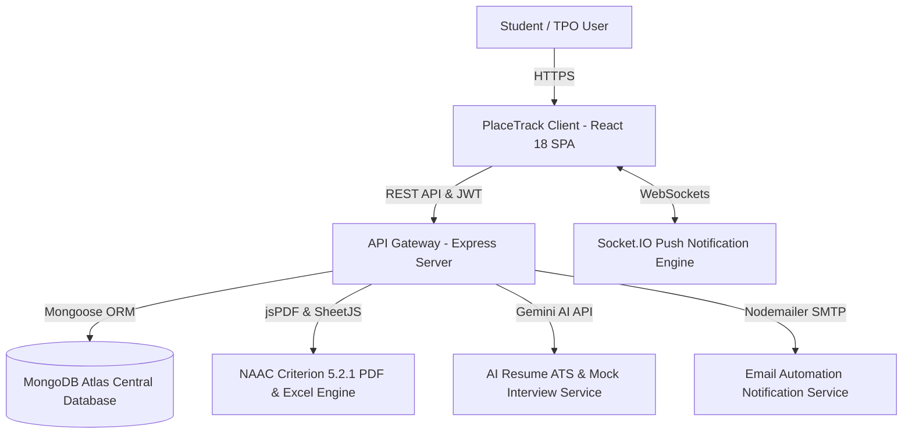

# PlaceTrack — Enterprise Student Placement Portal & Accreditation Engine

[](https://github.com/anoopcodehack/Student-Placement-Tracker)
[](https://react.dev)
[](https://nodejs.org)
[](https://mongodb.com)
[](https://socket.io)
[](https://naac.gov.in)
[](LICENSE)

An enterprise-grade campus recruitment automation platform and institutional accreditation reporting engine built for colleges and universities. Engineered to streamline placement operations, perform live drive eligibility checks with 1-click student registration, offer structured company preparation with an interactive question bank, and generate official NAAC Criterion 5.2.1 / NIRF audit PDF & Excel documentation.

---

## Live Deployment & Preview

| Environment | URL | Status |
| :--- | :--- | :--- |
| **Production Web Application** | [student-placement-tracker-navy.vercel.app](https://student-placement-tracker-navy.vercel.app) | `Active` |
| **API Health Check** | `https://student-placement-tracker.onrender.com/api/health` | `Active` |

---

## Key Core Pillars & Architecture



---

## Enterprise Feature Modules

### 1. Campus Recruitment Drives & 1-Click Apply Engine
* **Real-Time Drive Eligibility Engine**: Automatically cross-references incoming campus drive requirements against the logged-in student's live academic profile across 4 criteria:
  1. **Minimum CGPA** (e.g. $\ge 7.0$)
  2. **Maximum Backlogs Allowed** (e.g. $\le 0$)
  3. **Eligible Branches** (e.g. `CSE, ISE, ECE`)
  4. **Placement Status** (unplaced students only)
* **1-Click Apply & Immediate Audit Lock**: Eligible students can register for active campus drives with a single click. The backend validates criteria server-side and saves a point-in-time snapshot of the student's credentials.
* **Compound Unique Indexing**: `{ company: 1, student: 1 }` guarantees zero duplicate registrations under concurrent conditions.
* **Student Withdrawal Support**: Allows students to withdraw applications before drive cutoffs.
* **TPO Applicant Roster**: Placement officers can view registered student rosters with search filters and export company HR-ready `.xlsx` spreadsheets in 1 click.

---

### 2. Official NAAC Criterion 5.2.1 & NIRF Audit Report Generator
* **Institutional Accreditation Letterhead**: Formatted specifically for **Sahyadri College of Engineering & Management, Mangaluru** (*Autonomous Institute Affiliated to VTU Belagavi, AICTE Approved, NAAC 'A' Grade, NBA Accredited*).
* **Accreditation Key Indicators (Criterion 5.2.1)**:
  * Total Graduating Outgoing Cohort Strength
  * Total Verified Placed Students & Overall Institutional Placement Ratio (`%`)
  * Total Employment Offers Received
  * Compensation Metrics: Highest Package (`₹XX.XX LPA`) & Average Package (`₹XX.XX LPA`)
* **Department-Wise NAAC Audit Table**: Generates program-by-program breakdown of cohort size, placed count, unplaced count, placement percentage, and average CGPA.
* **NIRF Salary Tier Classification**: Classifies offers into Super Dream ($\ge 15\text{ LPA}$), Dream ($8 - 14.99\text{ LPA}$), Core IT ($5 - 7.99\text{ LPA}$), and Foundation ($< 5\text{ LPA}$) categories.
* **Official Attestation & Signatures**: Features certified sign-off boxes for **Placement Coordinator**, **Head - Training & Placement (TPO)**, and **Principal / Head of Institution** with college seal placeholders.
* **Multi-Page Vector PDF Output**: Vector lines, running headers, and running page numbering (`Page X of Y`) via `jsPDF` and `jspdf-autotable`.
* **NAAC Portal Excel Export**: Generates a 3-sheet `.xlsx` file formatted to match the NAAC SSR portal template.

---

### 3. Company Prep Hub & Interactive Interview Question Bank
* **Company Recruitment Guides**: Detailed round-by-round selection roadmaps (Online Assessment, Tech Round 1, Tech Round 2, HR/Managerial) for major campus recruiters:
  * *TCS, Infosys, Amazon, Google, Microsoft, Wipro, Swiggy, Accenture, Cognizant, PhonePe*
* **Topic-Categorized Question Bank**:
  * **Data Structures & Algorithms (DSA)**: Arrays, Linked Lists, Trees, Graphs, Sliding Window, DP.
  * **Database & SQL**: Subqueries, `DENSE_RANK()`, `GROUP BY ... HAVING`, Joins, Indexing, ACID.
  * **Core Computer Science**: Operating Systems (Processes vs. Threads), Computer Networks (DNS & TCP/IP), OOP Principles, System Design.
  * **Web Development**: Event Loop, Promises, REST API status codes, React mechanics.
  * **Quantitative Aptitude**: LCM unitary work method, Relative speed, Probability, Profit & Loss.
  * **HR & Behavioral**: 90-Second Self Introduction template, STAR behavioral methodology.
* **Expandable Solutions & Reference Code**: Step-by-step logic, syntax-highlighted code snippets, copy button, key takeaways, and gotcha tips.
* **Readiness Tracker**: LocalStorage-persisted "Mark as Mastered" progress bar (e.g., `12 / 24 Mastered (50% readiness)`).
* **Peer Contribution**: Placed students and administrators can contribute verified interview questions.

---

### 4. Placement Analytics & Executive Dashboard
* **Real-Time Metric Tiles**: Live placement rate percentage with visual progress bars, average package, highest package, total offers, and active companies.
* **Multi-Chart Intelligence**:
  * Branch-Wise Placement Comparison (Bar Chart)
  * Placed vs. Unplaced Cohort Breakdown (Doughnut Chart)
  * Salary Tier Package Distribution (Distribution Bar Chart)
  * Monthly Hiring Trends & Seasonality (Smooth Line Chart)
  * Top Recruiting Companies by Total Hires (Horizontal Bar Chart)
* **Batch Filtering**: Analyze historical placement trends across graduating classes (e.g. Batch 2023, 2024, 2025, 2026).

---

### 5. Role-Based Access Control (RBAC) & Security

| Feature / Action | Training & Placement Officer (Admin) | Student | Viewer / Faculty |
| :--- | :---: | :---: | :---: |
| **Executive Dashboard & Analytics** | Yes | Yes | Yes |
| **Campus Drives (View & Check Eligibility)** | Yes | Yes | Yes |
| **1-Click Apply & Withdraw Registration** | No | Yes | No |
| **View Applicant Rosters & Export HR Excel** | Yes | No | No |
| **Official NAAC Criterion 5.2.1 PDF Generator** | Yes | Yes | Yes |
| **Company Prep Hub & Question Bank** | Yes | Yes | Yes |
| **Mark Questions as Mastered** | No | Yes | No |
| **Add / Edit Student Academic Records** | Yes | Self Profile | No |
| **Add / Edit Company Recruiting Profiles** | Yes | No | No |
| **Record Verified Placements** | Yes | No | No |
| **Real-Time Push Notifications** | Yes | Yes | No |

---

## Technology Stack

```
Frontend:
  ├── React 18 (Functional components, custom hooks)
  ├── React Router v6 (SPA declarative routing)
  ├── Chart.js & react-chartjs-2 (Data visualization)
  ├── Bootstrap 5 & Bootstrap Icons (Clean developer layout)
  ├── jsPDF & jspdf-autotable (Institutional vector PDF generation)
  ├── SheetJS (xlsx) (Accreditation & HR spreadsheet generation)
  └── Socket.IO Client (Real-time duplex communication)

Backend:
  ├── Node.js & Express.js (RESTful micro-service API)
  ├── MongoDB & Mongoose ODM (Aggregation pipelines, compound indexing)
  ├── Socket.IO Server (Room-based push notification dispatch)
  ├── JWT & bcryptjs (Stateless auth & salted password hashing)
  ├── Nodemailer (Automated HTML email notifications)
  └── Google Generative AI SDK (Resume ATS keyword analyzer & mock interview bot)
```

---

## Project Structure

```
placement-tracker/
├── server/
│   ├── models/
│   │   ├── User.js                 # Authentication & studentRef linkage
│   │   ├── Student.js              # Academic credentials, CGPA, backlogs, branch
│   │   ├── Company.js              # Criteria (minCGPA, backlogs, branches), package
│   │   ├── DriveApplication.js    # Compound index { company: 1, student: 1 }
│   │   ├── PrepQuestion.js         # Curated question bank schema with filters
│   │   ├── Placement.js            # Verified job offers & compensation records
│   │   ├── Interview.js            # Senior interview experience writeups
│   │   └── Notification.js         # User alert logs
│   ├── routes/
│   │   ├── auth.js                 # JWT signin, signup, profile resolver
│   │   ├── applications.js         # Eligibility engine, 1-click apply & Excel export
│   │   ├── prep.js                 # Question bank, company hiring guides, upvotes
│   │   ├── stats.js                # Aggregation pipelines for overview & branch stats
│   │   ├── students.js             # Student CRUD, batch filters, search
│   │   ├── companies.js            # Recruiting partners CRUD
│   │   ├── placements.js           # Placement tracking & email trigger
│   │   ├── eligibility.js          # Direct company eligibility evaluations
│   │   ├── ats.js                  # Resume parser & ATS match analysis
│   │   └── mockInterview.js        # AI interview question generation & scoring
│   ├── socket/
│   │   └── socketHandler.js        # Real-time WebSocket emitter
│   ├── utils/
│   │   ├── studentHelper.js        # Auto-link user to student profile
│   │   └── emailService.js         # Nodemailer HTML templates
│   ├── index.js                    # Server bootstrap & WebSocket attach
│   └── database.js                 # MongoDB connection handler
│
└── client/
    ├── src/
    │   ├── pages/
    │   │   ├── Dashboard.js        # Executive KPIs, hero banner & analytics
    │   │   ├── CampusDrives.js     # Live criteria evaluation & 1-click apply
    │   │   ├── CompanyPrepHub.js   # Question bank, company guides & readiness bar
    │   │   ├── Students.js         # Student roster with filters & pagination
    │   │   ├── Companies.js        # Company directory & hiring stats
    │   │   ├── Placements.js       # Placement records & offer management
    │   │   ├── Analytics.js        # In-depth multi-chart reporting
    │   │   ├── Profile.js          # Student portal, resume upload & password
    │   │   └── Interviews.js       # Senior interview experiences
    │   ├── components/
    │   │   ├── NAACReportModal.js  # Interactive NAAC 5.2.1 audit preview modal
    │   │   ├── DriveApplicantsModal.js # HR applicant list & Excel exporter
    │   │   ├── Layout.js           # Responsive sidebar navigation & topbar
    │   │   ├── ConfirmModal.js     # Reusable confirmation dialogs
    │   │   └── NotificationBell.js # Real-time notification drawer
    │   ├── utils/
    │   │   ├── naacReportGenerator.js # Official vector PDF & NAAC Excel generator
    │   │   ├── exportUtils.js      # General XLSX & PDF exporter
    │   │   └── runtimeConfig.js    # Environment URL resolution
    │   └── index.css               # Design system & dark/light mode tokens
```

---

## REST API Reference

### 1. Campus Drive Applications (`/api/applications`)
| Method | Endpoint | Access | Description |
| :--- | :--- | :--- | :--- |
| `GET` | `/api/applications/drives` | Authenticated | Returns all active drives with computed student eligibility & status |
| `POST` | `/api/applications/apply/:companyId` | Student | 1-Click registration with server-side validation & snapshotting |
| `DELETE` | `/api/applications/withdraw/:companyId` | Student | Withdraws registered application |
| `GET` | `/api/applications/company/:id/applicants` | Admin / TPO | Returns full applicant roster with contact & academic info |
| `GET` | `/api/applications/my-applications` | Student | Returns student's active drive applications |

### 2. Company Prep Hub & Question Bank (`/api/prep`)
| Method | Endpoint | Access | Description |
| :--- | :--- | :--- | :--- |
| `GET` | `/api/prep/questions` | Authenticated | Returns questions filtered by topic, difficulty, company, search |
| `POST` | `/api/prep/questions` | Authenticated | Contributes a new question to the bank |
| `PUT` | `/api/prep/questions/:id/like` | Authenticated | Upvotes / marks question as helpful |
| `GET` | `/api/prep/companies` | Authenticated | Returns curated round-by-round company recruitment guides |

### 3. Analytics & Statistics (`/api/stats`)
| Method | Endpoint | Access | Description |
| :--- | :--- | :--- | :--- |
| `GET` | `/api/stats/overview` | Authenticated | Key indicators (Total students, placed, rate, avg/max package) |
| `GET` | `/api/stats/branch-wise` | Authenticated | Department-wise cohort size, placed count, average CGPA |
| `GET` | `/api/stats/package-distribution` | Authenticated | CTC tier classification counts |
| `GET` | `/api/stats/monthly-trend` | Authenticated | Monthly offer volume & average package seasonality |
| `GET` | `/api/stats/company-wise` | Authenticated | Top recruiters by total offers extended |
| `GET` | `/api/stats/batches` | Authenticated | Available graduating batch cohorts |

---

## Local Development & Setup

### Prerequisites
* **Node.js**: v18.0.0 or higher
* **MongoDB**: Local MongoDB instance or MongoDB Atlas cluster connection string
* **Package Manager**: npm or yarn

### 1. Clone the Repository
```bash
git clone https://github.com/anoopcodehack/Student-Placement-Tracker.git
cd Student-Placement-Tracker
```

### 2. Backend Configuration & Startup
Navigate into the server directory:
```bash
cd placement-tracker/server
npm install
```

Create a `.env` file in `placement-tracker/server/` (refer to `.env.example`):
```env
PORT=5000
MONGO_URI=your_mongodb_connection_string
JWT_SECRET=your_secure_jwt_secret_key
CLIENT_URL=http://localhost:3000
NODE_ENV=development

# Optional Integrations
GEMINI_API_KEY=your_gemini_api_key
EMAIL_USER=your_college_tpo_email@gmail.com
EMAIL_PASS=your_gmail_app_password
```

Start the backend server:
```bash
npm run dev
# Server starts on http://localhost:5000 with MongoDB connected & auto-seeded
```

### 3. Frontend Configuration & Startup
In a separate terminal, navigate into the client directory:
```bash
cd placement-tracker/client
npm install
npm start
# Client application opens at http://localhost:3000
```

---

## Demo Credentials

| Role | Email ID | Password | Access Capabilities |
| :--- | :--- | :--- | :--- |
| **Placement Officer (Admin)** | `admin@college.edu` | `admin123` | Full portal access, drive creation, applicant exports, NAAC audit generator |
| **Student** | Sign up with any USN / Roll No | Self-selected | Personal eligibility engine, 1-click apply, prep hub, ATS scanner |
| **Auditor / Faculty (Viewer)** | `viewer@college.edu` | `viewer123` | Read-only analytics, dashboard, and accreditation metrics inspection |

---

## Institutional Context & Attribution

Developed for **Sahyadri College of Engineering & Management, Mangaluru** to support the Training & Placement Department, improve placement outcomes, and streamline documentation for NAAC (Criterion 5.2.1), NBA, and NIRF audits.

**Lead Developer & Maintainer:**
* **Anoop A** — Full Stack Developer & GFG Campus Mantri, Sahyadri College
* GitHub: [@anoopcodehack](https://github.com/anoopcodehack)
* LinkedIn: [Anoop A](https://www.linkedin.com/in/anoop-a-95b7b3331/)

---

## License

This project is licensed under the **MIT License**. Free to use, adapt, and build upon for educational and institutional placement management.
